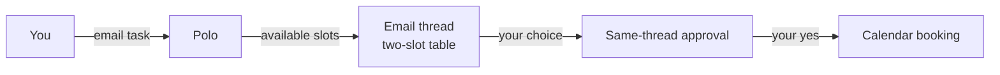

# polo

Call, message or email one agent to handle tasks across your calendar, mail and
web. Polo asks for your approval in the same channel and shows a form, table or
button where the channel supports generated UI.

## Install

Install Polo 0.1.0 with Homebrew:

```sh
brew install stevenjpx2/taps/polo
```

## Set up Polo

Choose your model, channels and MCP servers in `polo.config.ts`:

```ts
export default {
  model: "anthropic/claude-sonnet-5-5",
  channels: ["phone", "imessage", "email"],
  mcps: ["calendar", "mail", "web"],
};
```

Check which channels are connected:

```sh
polo channels
```

## Book a planning session by email

Email Polo: "Find two half-hour slots on Tuesday for planning, and book the one
I pick."



Polo checks your calendar and replies in the email thread with a small table:

| Option | Tuesday slot |
| ------ | ------------ |
| 1      | 10:00–10:30  |
| 2      | 14:00–14:30  |

Reply "Option 1." Polo asks you to approve a planning event for Tuesday,
10:00–10:30, in the same thread. Reply "Yes" to approve; Polo creates the event
and confirms the booking there.

## Use another channel

Message Polo through iMessage or call it by phone to ask for help with the same
calendar, mail and web tools. An action that needs your approval asks in the
channel you are using.

Where a channel supports generated UI, Polo presents forms, tables and buttons
for choosing and approving. Email carries the options and approval in the
thread; phone carries them in the conversation.

## Roadmap

- [ ] Email channel
- [ ] iMessage/chat channel
- [ ] Phone channel
- [ ] Generated UI and same-channel approvals
- [ ] Publish polo 0.1.0 to the wrkhse/tap tap

## More

- [Design](https://github.com/wrkhse/polo/issues/1)
- [Harness notes](https://github.com/wrkhse/tack/issues/26)
- [Workhorse philosophy](https://github.com/wrkhse/workhorse/blob/main/PHILOSOPHY.md)
